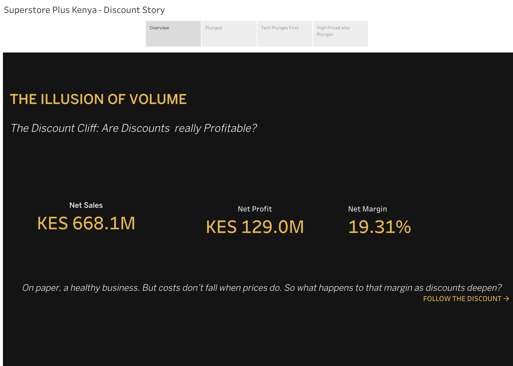
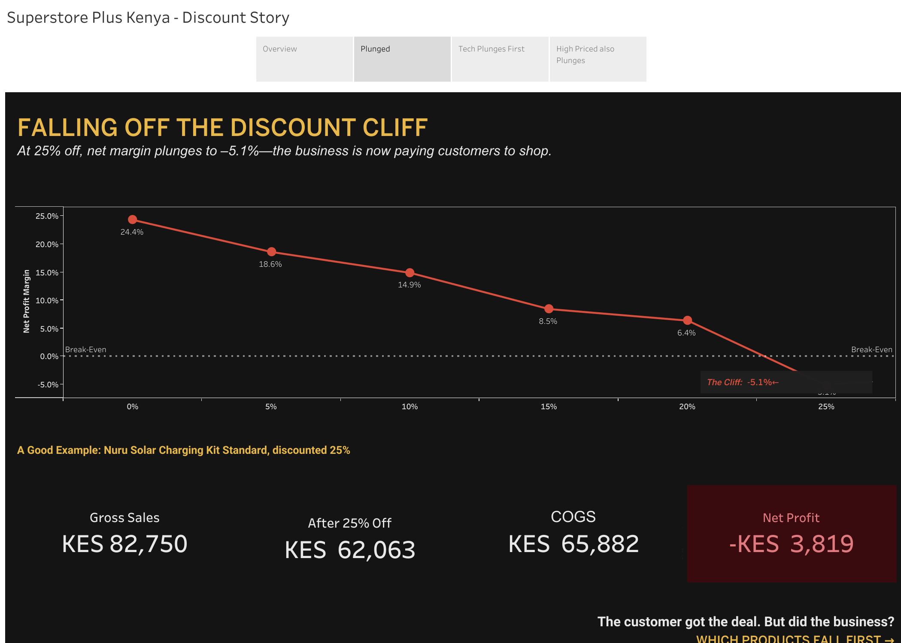
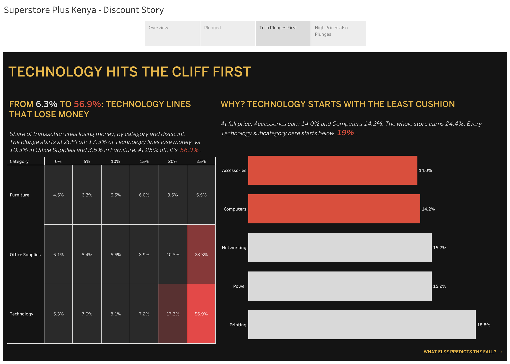
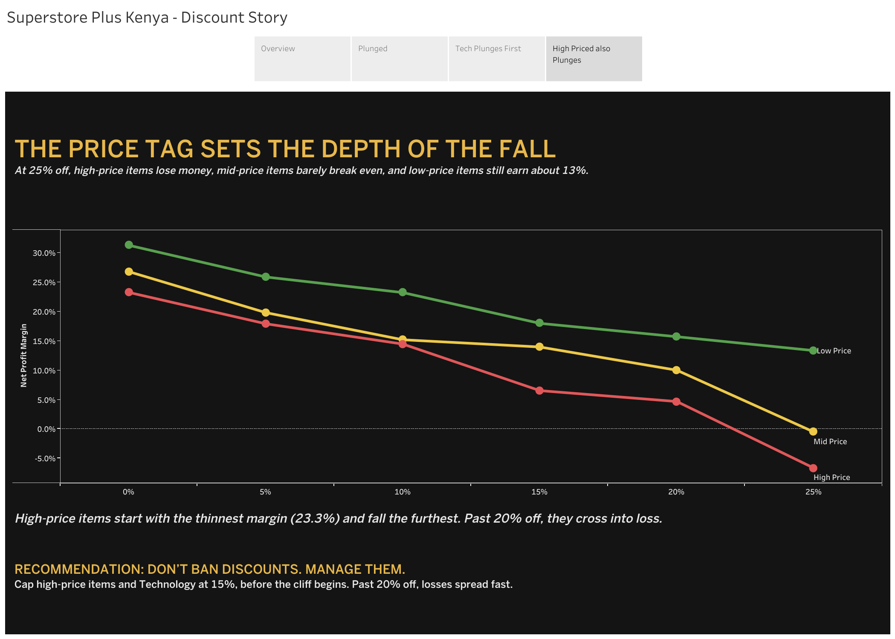

# Superstore Plus Kenya: The Discount Cliff

> **The customer got the deal. But did the business?**

A Tableau data-storytelling project exploring how retail discounts affect profitability across discount levels, product categories, and product price segments.

The central insight: **strong headline sales do not guarantee that every transaction is profitable.** This story looks beyond volume to identify where margins weaken, which categories are most exposed, and where businesses may need stronger discount guardrails.

---

## Project Snapshot

| Business metric | Value |
|---|---:|
| Net sales | KES 668.1M |
| Net profit | KES 129.0M |
| Overall net margin | 19.3% |

*The 19.3% margin represents the overall business. The 24.4% figure in the discount analysis refers specifically to transactions with no discount.*

## The Visual Story

### 1. The Illusion of Volume

Headline sales and profit look healthy—but totals can hide risk. The overview establishes the business context and asks whether sales performance tells the full profitability story.



### 2. Falling Off the Discount Cliff

Profitability declines as discounts deepen. In the observed data, the net profit margin falls from **24.4% at 0% discount** to **-5.1% at 25% discount**.

| Discount level | Net profit margin |
|---:|---:|
| 0% | 24.4% |
| 5% | 18.6% |
| 10% | 14.9% |
| 15% | 8.5% |
| 20% | 6.4% |
| 25% | -5.1% |

At 25% off, the transaction group records a negative margin: the discount may attract a buyer, but the sale can still lose money.



### 3. Technology Hits the Cliff First

At a 25% discount, Technology has the highest share of loss-making transaction lines among the three categories compared.

| Category | Loss-making transaction lines at 25% discount |
|---|---:|
| Technology | 56.9% |
| Office Supplies | 28.3% |
| Furniture | 5.5% |

These percentages represent the **share of transaction lines that lost money**, not the share of revenue lost. Technology subcategories also had relatively thin margins at full price, increasing the risk of deep discounts.



### 4. The Price Tag Sets the Depth of the Fall

The same discount does not affect every price segment equally.

- **High-price items:** started with a 23.3% margin at full price and moved into losses beyond a 20% discount.
- **Mid-price items:** were close to break-even at a 25% discount.
- **Low-price items:** retained approximately a 13% margin at a 25% discount.

This suggests discount decisions should account for product economics—not just apply one blanket rate to every item.



---

## A Transaction That Makes the Risk Real

The **Nuru Solar Charging Kit Standard** illustrates how a discount can reduce revenue below product cost.

| Transaction metric | Amount |
|---|---:|
| Gross sales | KES 82,750 |
| Sales after 25% discount | KES 62,063 |
| Cost of goods sold | KES 65,882 |
| Reported loss | KES 3,819 |

*Amounts are rounded as presented in the Tableau story.*

The customer received the deal. The business absorbed the loss.

## Business Recommendation

**Do not ban discounts. Manage them.**

Based on the observed patterns, the project proposes:

1. **Use a 15% discount cap as a starting guardrail** for Technology and high-price items.
2. **Check product-level profitability** before approving deeper promotions.
3. **Review exceptions individually**, considering product cost, demand, inventory goals, and the full cost structure.
4. **Monitor margin as well as sales volume** so that promotions are assessed on the quality of sales, not just the number or value of transactions.

The 15% cap is a proposed guardrail—not a proven optimal discount rate. It should be tested against business objectives and additional data before being adopted as policy.

## Business Questions

- How does net profit margin change across discount levels?
- Which categories have the largest share of loss-making transaction lines at a deep discount?
- Are high-price items more vulnerable to deep discounts?
- What practical discount controls could help protect profitability?

## Tools and Analytical Approach

- **Visualization tool:** Tableau
- **Project format:** Four-part visual data story
- **Analysis:** Net margin by discount level, loss-making transaction lines by category, and margin by price segment
- **Supporting example:** A transaction where discounted sales fell below cost of goods sold

## Limitations

- The analysis compares observed transaction groups; it does not prove that discounts alone caused the profitability differences.
- Product mix and other characteristics may differ between discount groups.
- The analysis does not quantify whether additional sales volume offsets the margin lost through discounting.
- The source story uses the labels “net profit” and “net margin,” but the full cost definition is not documented in the supplied presentation. The transaction example specifically compares sales with cost of goods sold.
- Dataset provenance, reporting period, and the thresholds used to define low-, mid-, and high-price segments are not specified in the supplied presentation.
- Findings should be interpreted within this dataset and should not automatically be generalized to every Kenyan retailer.

## Repository Structure

Keep the README and image files organized like this so the visuals render correctly on GitHub:

```text
superstore-plus-kenya-discount-cliff/
├── README.md
└── images/
    ├── overview.png
    ├── discount-cliff.png
    ├── technology-risk.png
    └── price-segments.png
```

## Portfolio Takeaway

This project demonstrates how data visualization can turn retail performance figures into a business narrative: headline sales are only part of the story, because **what matters is how much profit the business keeps**.

